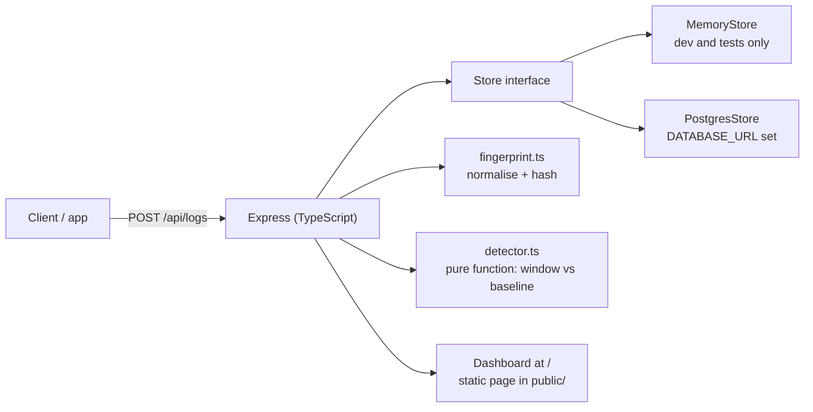

# Log Anomaly Watcher

Know when your logs go wrong: a known error suddenly spiking, or a brand-new error appearing for the first time. No black-box model, no vendor lock-in, just transparent rules you can read and tune.

Log Anomaly Watcher is a small Node.js/TypeScript service. You send it logs over HTTP. It groups them by error signature, then surfaces anomalies with plain statistical rules: window count versus a baseline average. A minimal dashboard at `/` lists current anomalies and the top signatures.

## What problem it solves

Small teams often have no budget for Sentry or Datadog, but still need to know when something in production starts failing more than usual. Grepping logs after users complain is too late. This service gives you the cheapest useful version of that awareness: ingest logs, group repeats into one signature, and flag spikes and first-time errors while they are happening.

## Key features

- **HTTP log ingestion.** `POST /api/logs` accepts one log, a JSON array, or `{ "logs": [...] }`. Returns `201` with `{ "accepted": n }`.
- **Fingerprinting.** Messages are normalised before hashing: UUIDs, IPv4 addresses, hex values, quoted strings, and numbers become placeholders. `Database timeout for user 12345` and `Database timeout for user 67890` become one signature. Fingerprints are scoped per service, so the same message in two services stays distinct. The fingerprint is the first 16 hex characters of a SHA-256 hash of `service` plus the normalised message.
- **Spike detection.** Compares the last window (default 10 minutes) against the previous hour, expressed as an average per window. A spike fires only when both conditions hold: window count is at least the minimum (default 5) and at least the baseline average times the multiplier (default 3).
- **New-signature detection.** A signature first seen inside the current window (and within the lookback, default 24 hours) is flagged as new. A signature with baseline history is not flagged as new, so a spike is never hidden behind the new label. Note: in this version new-signature detection applies to every log level, not only errors. An info message seen for the first time is flagged too. See [Limitations](#limitations).
- **Severity levels.** Spikes are `critical` when the ratio is 10x or more, or the window count is 50 or more; `high` when the ratio is 5x or more; otherwise `medium`. New signatures are always `medium`.
- **Signature listing.** `GET /api/signatures` returns signatures ordered by count, with a per-level breakdown and first/last seen timestamps. Filter with `?service=api`.
- **Anomaly listing.** `GET /api/anomalies` returns each anomaly with its type, severity, window count, baseline per window, ratio, first/last seen, and a human-readable reason. Filter with `?service=` and `?severity=`.
- **Minimal dashboard.** A single static page at `/` shows current anomalies and the top 20 signatures, with a Refresh button and a 30-second auto-refresh.
- **Two stores behind one interface.** An in-memory store for development and tests, and a Postgres store for durable use. The table is created automatically on first use.
- **Demo seed script.** `npm run demo` posts a baseline, a spike, and a new signature, then prints the resulting anomalies.

## Screenshots

There is no headless browser on the machine used to prepare these docs, so there are no GUI screenshots. What exists instead are genuine terminal captures from a real run on 2026-11-06, kept in `docs/screenshots/`:

- `test-run.txt` - `npm test`: 3 test files, 12 tests, all passing.
- `server-and-api.txt` - real `curl` calls against the running server: health check, log ingest, signatures, anomalies, a rejected invalid level, and the dashboard returning HTTP 200.
- `demo-seed.txt` - `npm run demo` output: 23 logs seeded, one critical spike (12 events vs a baseline of 1.00 per window, ratio 12.0x) and two new signatures.

The dashboard itself is a plain static page (see `public/index.html`): a heading, a Refresh button, an anomalies list, and a table of the top signatures. It has no charts and no login screen.

## Architecture



Detection is a pure function of stored events, so it is unit-tested without a database. The store interface is the only seam between the in-memory and Postgres implementations. The API layer validates input, the fingerprint module normalises messages, and the detector compares the current window against the baseline.

Request flow:

1. A client posts logs to `POST /api/logs`. Each log is validated (`service`, `level`, `message`, optional ISO `timestamp`) and fingerprinted.
2. Events are stored through the `Store` interface (`addMany`).
3. A read of `GET /api/anomalies` loads events since the baseline start plus all signature stats, then runs `detectAnomalies` and returns the result. Nothing is detected at ingest time; detection happens on read.
4. `GET /api/signatures` returns aggregated stats from the store.

## Tech stack

- Node.js 22 and TypeScript 5 (strict mode, CommonJS, output to `dist/`)
- Express 4 for the HTTP API and static dashboard
- `pg` 8 for the Postgres store
- Vitest 2 with Supertest for tests
- `tsx` for `npm run dev` (watch mode)
- Docker: multi-stage `Dockerfile` (Node 22 Alpine) and `docker-compose.yml` with Postgres 17

## Prerequisites

- Node.js 18 or newer (Node 22 is used by the Dockerfile; tested here on Node 24). npm ships with Node.
- Optional: Docker and Docker Compose, for the Postgres-backed setup. The Postgres path and the Docker setup have not been run live in this environment (no Docker here), so treat them as documented but unverified. See [Limitations](#limitations).

## Installation

```bash
git clone https://github.com/mrpythonist/log-anomaly-watcher.git
cd log-anomaly-watcher
npm install
```

To use Postgres locally without Docker, set `DATABASE_URL` to a reachable Postgres instance (see [Configuration](#configuration)). Without `DATABASE_URL` the service uses the in-memory store.

## Configuration

Copy `.env.example` to `.env` for local runs. All values below are the defaults. The service reads plain environment variables; there is no config file loader, so export them or use your own process manager to set them.

| Variable | Default | Meaning |
| --- | --- | --- |
| `PORT` | `3000` | HTTP port |
| `DATABASE_URL` | unset | Postgres connection string. Unset means the in-memory dev store, which loses data on restart. |
| `WINDOW_MINUTES` | `10` | Current window for spike detection, in minutes |
| `BASELINE_HOURS` | `1` | Baseline period immediately before the window, in hours |
| `SPIKE_MULTIPLIER` | `3` | Spike threshold as a multiple of baseline per window |
| `SPIKE_MIN_COUNT` | `5` | Minimum window count for a spike |
| `NEW_SIGNATURE_LOOKBACK_HOURS` | `24` | First-seen window for new-signature detection, in hours |

Invalid or non-positive numeric values fall back to the defaults. See `.env.example` for a copy-ready example.

## Quick start

### With Docker (Postgres included)

```bash
docker compose up --build
# Dashboard: http://localhost:3000
# Health:    curl http://localhost:3000/api/health
```

Note: this path has not been run live in the environment where these docs were written (no Docker available). The compose file and Dockerfile are present and reviewed, but not executed. If you run it and find a problem, please open an issue.

### Locally (in-memory dev store)

```bash
npm install
npm run dev
# Dashboard: http://localhost:3000
```

Without `DATABASE_URL` the service uses the in-memory store: data is lost on restart and it is not suitable for production. Set `DATABASE_URL` to use Postgres; the `logs` table is created automatically on first use.

### Production build

```bash
npm run build
npm start
# Serves from dist/ on PORT (default 3000)
```

### Demo

With the server running:

```bash
npm run demo
```

This seeds a baseline of 6 `Database timeout` events in the previous hour, 12 more in the last 5 minutes (a spike, ratio 12x), and a brand-new `Payment gateway rejected card` signature, then prints the anomalies. It also seeds two `Cache miss` info events; in this version the first of those is flagged as a new signature too, because new-signature detection applies to all levels. See the real output in `docs/screenshots/demo-seed.txt`.

## Usage and API reference

Base URL: `http://localhost:3000` by default. All responses are JSON. The JSON body limit is 1 MB.

### GET /api/health

Returns `{ "ok": true, "store": "postgres" }` or `{ "ok": true, "store": "memory" }`.

```bash
curl http://localhost:3000/api/health
# {"ok":true,"store":"memory"}
```

### POST /api/logs

Accepts a single log object, a JSON array of logs, or `{ "logs": [...] }`. Returns `201` with `{ "accepted": n }`.

```bash
curl -X POST http://localhost:3000/api/logs \
  -H 'Content-Type: application/json' \
  -d '{"service":"api","level":"error","message":"Database timeout for user 12345"}'
# {"accepted":1}
```

Fields:

| Field | Required | Rules |
| --- | --- | --- |
| `service` | yes | Non-empty string. Fingerprints are scoped per service. |
| `level` | yes | One of `debug`, `info`, `warn`, `error`, `fatal`. |
| `message` | yes | Non-empty string. |
| `timestamp` | no | Valid ISO date string. Defaults to now. |

Validation failures return `400` with `{ "error": "..." }`. An empty array or `{ "logs": [] }` returns `400` with `{ "error": "no logs provided" }`. If any item in a batch is invalid, the whole batch is rejected and nothing is stored.

```bash
curl -X POST http://localhost:3000/api/logs \
  -H 'Content-Type: application/json' \
  -d '{"service":"api","level":"critical","message":"boom"}'
# {"error":"level must be one of: debug, info, warn, error, fatal"}
```

### GET /api/signatures

Returns signatures ordered by count (highest first), each with `signature`, `service`, `normalized`, `count`, `levels` (per-level counts), `firstSeen`, and `lastSeen` (ISO strings).

```bash
curl http://localhost:3000/api/signatures
curl "http://localhost:3000/api/signatures?service=api"
```

Example response (one signature):

```json
{"signatures":[{"signature":"087af866c0dd0230","service":"api","normalized":"Database timeout for user <num>","count":1,"levels":{"error":1},"firstSeen":"2026-11-06T05:02:31.739Z","lastSeen":"2026-11-06T05:02:31.739Z"}]}
```

### GET /api/anomalies

Returns `{ "anomalies": [...], "windowMinutes": 10, "generatedAt": "<ISO>" }`. Each anomaly has `type` (`spike` or `new_signature`), `signature`, `service`, `normalized`, `windowCount`, `baselinePerWindow`, `ratio` (null when the baseline is zero), `severity` (`medium`, `high`, or `critical`), `firstSeen`, `lastSeen`, and a human-readable `reason`.

```bash
curl http://localhost:3000/api/anomalies
curl "http://localhost:3000/api/anomalies?service=api&severity=critical"
```

Example response (spike):

```json
{"anomalies":[{"type":"spike","signature":"342cb2ffe5ba4ad6","service":"api","normalized":"Database timeout","windowCount":12,"baselinePerWindow":1,"ratio":12,"severity":"critical","firstSeen":"2026-11-06T04:07:09.168Z","lastSeen":"2026-11-06T04:57:09.168Z","reason":"12 events in the last 10 minutes vs a baseline of 1.00 per window (ratio 12.0x, threshold 3x, minimum 5)."}],"windowMinutes":10,"generatedAt":"2026-11-06T05:02:10.031Z"}
```

### GET /

The dashboard. A static HTML page that fetches `/api/anomalies` and `/api/signatures`, lists current anomalies with severity styling, and shows the top 20 signatures in a table. Returns HTTP 200 with `Content-Type: text/html`.

## Project structure

```
.
├── src/
│   ├── server.ts        # Entry point: loads config, starts the HTTP server, handles SIGINT/SIGTERM
│   ├── app.ts           # Express app: routes, validation, store selection
│   ├── config.ts        # Environment variable parsing with defaults
│   ├── detector.ts      # Pure detection logic (window vs baseline), no I/O
│   ├── fingerprint.ts   # Message normalisation and SHA-256 fingerprinting
│   ├── types.ts         # LogEvent, SignatureStats, Store interface, log levels
│   ├── memoryStore.ts   # In-memory store (dev and tests only)
│   └── postgresStore.ts # Postgres store (durable; creates table and indexes on first use)
├── test/
│   ├── api.test.ts        # HTTP validation, grouping, and anomaly endpoint
│   ├── detector.test.ts   # Spike rules, minimum count guard, new signatures, steady traffic
│   └── fingerprint.test.ts# Normalisation cases
├── public/
│   └── index.html       # Dashboard (static, fetched by the browser)
├── scripts/
│   └── seed-demo.js     # Demo seed: baseline, spike, new signature
├── docs/
│   ├── architecture.md  # Design, data flow, and trade-offs
│   ├── development.md   # Local setup, scripts, and conventions
│   ├── api.md           # Full API reference with examples
│   └── screenshots/     # Genuine terminal captures from a real run
├── Dockerfile
├── docker-compose.yml
├── .env.example
├── package.json
└── tsconfig.json
```

## Testing

```bash
npm test
```

Runs Vitest (`vitest run`) across `test/`. The suite has 12 tests in 3 files, all passing as of the last run on 2026-11-06 (see `docs/screenshots/test-run.txt`):

- `test/fingerprint.test.ts` (4 tests): normalisation of numbers, UUIDs, IPs, and quoted strings.
- `test/detector.test.ts` (4 tests): spike detection, the minimum-count guard, new-signature detection, and steady traffic producing no anomaly.
- `test/api.test.ts` (4 tests): request validation (missing message, unknown level, bad timestamp) and signature grouping through the HTTP API.

There is no lint script configured in `package.json`. `npm run build` (`tsc`, strict mode) is the compile check and must pass before a PR is considered ready.

## Deployment

The service is a single Node.js process with no background workers. Deployment options, in order of simplicity:

1. **Docker Compose (documented, not yet run live here).** `docker compose up --build` starts Postgres 17 and the app. The app waits for Postgres to be healthy (`depends_on` with `service_healthy`). Change the default Postgres credentials in `docker-compose.yml` before any shared or internet-facing use; `logwatcher`/`logwatcher` is a local development default only.
2. **Plain Node.** Build with `npm run build`, set `DATABASE_URL` and the other variables, and run `npm start` (or `node dist/server.js`) under a process manager such as systemd or PM2. The server handles `SIGINT` and `SIGTERM` with a graceful shutdown that closes the store.
3. **Container image only.** Build the `Dockerfile` (multi-stage, Node 22 Alpine, production dependencies only) and run it with `DATABASE_URL` pointing at a managed Postgres instance.

There is no hosted demo, no Helm chart, and no CI-deployed environment. The service is stateless except for its store: the in-memory store loses data on restart, and the Postgres store holds everything in a single `logs` table with indexes on `(signature, ts)` and `(ts)`.

## Security

- There is **no authentication** on any endpoint. Do not expose this service on the public internet without adding auth in front of it (a reverse proxy with basic auth, an API gateway, or a private network).
- Logs are stored as received, including the original message text. Do not send secrets, tokens, or personal data in log messages; the fingerprinting step only normalises numbers, UUIDs, IPs, hex values, and quoted strings, and the raw message is still stored.
- The default Postgres credentials in `docker-compose.yml` are for local development only. Change them before any non-local use.
- The JSON body limit is 1 MB, which bounds the size of a single ingest request.
- To report a security issue, see [SECURITY.md](SECURITY.md). Do not open a public issue with exploit details.

## Limitations

Honest limits of this version (v0.1.0). These are deliberate omissions or known gaps, not oversights to hide.

- **Not a replacement for Sentry or Datadog.** No tracing, no alerting channels (email, Slack, webhooks), no log search, no retention policy, no multi-tenant auth.
- **No ML or AI model.** Detection is transparent statistical rules (window count vs baseline average). Nothing is trained or inferred.
- **New signatures are flagged at every level.** A first-time `info` message is flagged just like a first-time `error`. If you only care about errors, filter by level in your own client or watch for a future option to restrict new-signature detection by level.
- **Single instance.** The in-memory store and the Postgres queries both assume one service instance. There is no sharding or distributed aggregation.
- **Baseline can mask a spike.** The baseline is the previous hour. If the baseline itself contains an incident, a spike may not cross the threshold. A longer or median-based baseline would be the next improvement.
- **First seen means first seen by this deployment.** After a store reset, old signatures re-flag once as new. Use Postgres for durable use to avoid this.
- **Postgres and Docker paths are unverified.** The Postgres store, the Dockerfile, and `docker-compose.yml` have not been run live in the environment where these docs were written (no Docker available). The code is reviewed and the SQL is straightforward, but treat these paths as untested until someone runs them. The in-memory path is verified: tests pass, the build is clean, and the server was run and exercised over HTTP.
- **Clock dependence.** Detection uses log timestamps as supplied, so clients with badly skewed clocks distort windows and baselines.
- **Query cost at scale.** The Postgres query path reads events since the baseline start, which is fine at small-team scale and a bottleneck at high volume. Pre-aggregated counters would be the scaling step.

## Roadmap

Ideas under consideration, in no promised order. Nothing here is a commitment.

- Restrict new-signature detection to `error` and `fatal` levels, or make the levels configurable.
- Alerting channels: webhook, Slack, and email notifications for new anomalies.
- Retention policy and automatic cleanup of old events.
- Median-based or longer baselines to reduce masking by incidents inside the baseline.
- Authentication for the API and dashboard.
- Log search and filtering in the dashboard.
- Pre-aggregated counters for high-volume Postgres use.
- Verified Docker and Postgres setup, with a CI job that runs the compose stack.

## Contributing

Contributions are welcome. See [CONTRIBUTING.md](CONTRIBUTING.md) for setup, branch and commit conventions, testing requirements, and the pull request process. By participating you agree to the [Code of Conduct](CODE_OF_CONDUCT.md).

## License

MIT. See [LICENSE](LICENSE).
