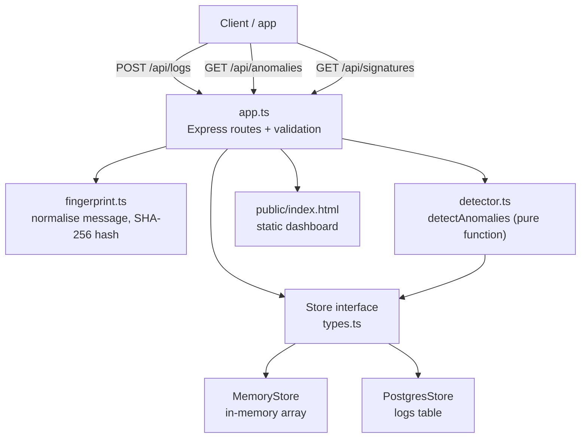
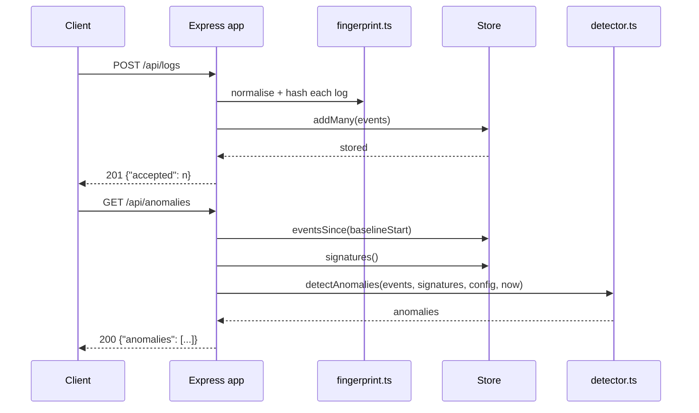

# Architecture

## Overview

Log Anomaly Watcher is a single Node.js process. An Express app accepts logs over HTTP, stores them through a `Store` interface, and answers reads by running a pure detection function over the stored events. There are no background workers, no queues, and no scheduled jobs. Detection happens on read, not at ingest time.

## Components



### `src/server.ts`

Entry point. Loads config, creates the app, starts listening on `PORT`, and handles `SIGINT` and `SIGTERM` with a graceful shutdown that closes the HTTP server and then the store.

### `src/app.ts`

Creates the Express app and wires the routes. Responsibilities:

- Parses JSON bodies with a 1 MB limit.
- Serves the static dashboard from `public/`.
- Validates every incoming log (service, level, message, optional timestamp) and rejects the whole batch with `400` if any item is invalid.
- Selects the store: a `PostgresStore` when `DATABASE_URL` is set, otherwise a `MemoryStore`. A store passed in directly (used by tests) is treated as the memory kind for the health endpoint.
- Implements the four routes: `GET /api/health`, `POST /api/logs`, `GET /api/signatures`, `GET /api/anomalies`.

### `src/fingerprint.ts`

Normalises a log message so the same failure with different variable parts maps to one signature. Replacements happen in a fixed order, specific patterns first:

1. UUIDs become `<uuid>`.
2. IPv4 addresses become `<ip>`.
3. Hex values (`0x...`) become `<hex>`.
4. Quoted strings become `<str>`.
5. Numbers (integers and decimals) become `<num>`.

Whitespace is collapsed first. The fingerprint is the first 16 hex characters of SHA-256 over `service` plus a newline plus the normalised message, so the same message in two services produces different signatures.

### `src/detector.ts`

`detectAnomalies(events, signatures, config, now)` is a pure function: no I/O, no database access, fully unit-testable. It works in three steps:

1. **Split events into window and baseline.** The window is the last `windowMinutes` before `now`. The baseline is the `baselineHours` immediately before the window, converted to an average per window (`baselineHours * 60 / windowMinutes` windows).
2. **Classify each signature that appears in the window.** A signature whose first sighting is inside the current window (and within the `newSignatureLookbackHours` lookback) is reported as `new_signature` with severity `medium`. This check runs first, so a genuinely new signature is never reported as a spike instead.
3. **Check the spike rule for the rest.** A spike fires only when both conditions hold: window count is at least `spikeMinCount`, and window count is at least `baselinePerWindow * spikeMultiplier`. A zero baseline cannot fire a spike; that case is covered by new-signature detection when the signature is genuinely new. Severity is `critical` when the ratio is 10 or more or the window count is 50 or more, `high` when the ratio is 5 or more, otherwise `medium`.

Results are sorted by window count, highest first.

Important behaviour of this version: new-signature detection applies to every log level. A first-time `info` message is flagged just like a first-time `error`. This is the behaviour of the public 0.1.0 code, and it is visible in the demo seed output (see `docs/screenshots/demo-seed.txt`, where a `Cache miss` info event is flagged as a new signature).

### `src/config.ts`

Reads environment variables with defaults and falls back to the default for any missing, empty, non-numeric, or non-positive value. See the configuration table in the README.

### Stores

Both stores implement the `Store` interface from `src/types.ts`: `add`, `addMany`, `eventsSince(since)`, `signatures()`, and `close()`.

**MemoryStore** (`src/memoryStore.ts`). Holds events in an array. `signatures()` aggregates in memory, ordered by count descending. Data is lost on restart and `close()` clears the array. This is the development and test store.

**PostgresStore** (`src/postgresStore.ts`). Opens a `pg` pool and creates the table on first use:

```sql
CREATE TABLE IF NOT EXISTS logs (
  id BIGSERIAL PRIMARY KEY,
  service TEXT NOT NULL,
  level TEXT NOT NULL,
  message TEXT NOT NULL,
  normalized TEXT NOT NULL,
  signature TEXT NOT NULL,
  ts TIMESTAMPTZ NOT NULL
);
CREATE INDEX IF NOT EXISTS logs_signature_ts ON logs (signature, ts);
CREATE INDEX IF NOT EXISTS logs_ts ON logs (ts);
```

`eventsSince` reads all events at or after the given time, ordered by timestamp. `signatures()` aggregates with `GROUP BY signature, service, normalized` plus a second query for per-level counts. Both the original message and the normalised message are stored.

The Postgres store has not been run live in the environment where these docs were written (no Docker available). The code is reviewed and the SQL is straightforward, but treat this path as unverified until someone runs it.

### Dashboard

`public/index.html` is a single static page with inline CSS and JavaScript. It fetches `/api/anomalies` and `/api/signatures`, renders anomalies as cards with severity styling, and renders the top 20 signatures in a table. It refreshes on button click and every 30 seconds. There is no build step and no login.

## Data flow



## Design decisions and trade-offs

- **Detection on read, not at ingest.** Ingest stays fast and simple, and the same stored events can be re-evaluated with different settings. The cost is that every read scans events since the baseline start, which is fine at small-team scale and a bottleneck at high volume.
- **Rules over models.** A multiplier plus a minimum count is easy to explain to an on-call engineer and easy to tune. The cost is missing slow drifts that a model might catch.
- **Baseline is the previous hour.** Simple and explainable, but a baseline that itself contains an incident masks a spike. A longer or median-based baseline would be the next improvement.
- **First seen means first seen by this deployment.** "New signature" means new to this store, not new to the world. After a store reset, old signatures re-flag once. Using Postgres for durable use avoids this.
- **One service instance.** Both stores assume a single instance. There is no sharding or distributed aggregation.
- **Raw messages are stored.** The original message is kept alongside the normalised form so a human can read what actually happened. The cost is that any sensitive data sent in a log message is stored; clients must not send secrets in logs.
